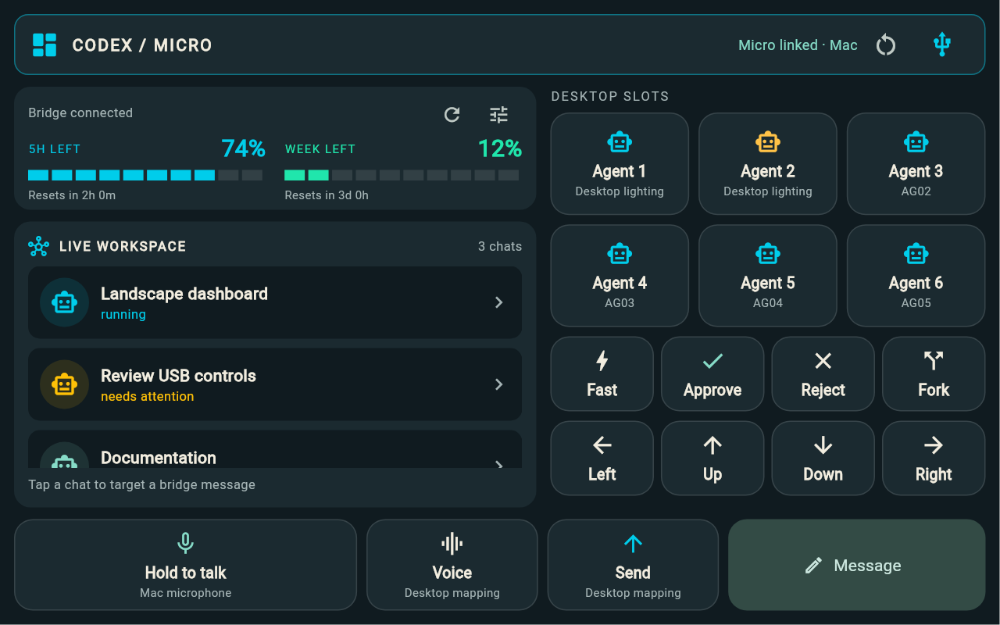

# Landscape dashboard

The tablet starts in landscape (either cable direction). It adapts the owner's
[FNK0104B Codex monitor](https://github.com/cmwen/FNK0104B/tree/main/apps/codex-monitor):
dark panels, cyan/mint segmented **remaining** quota, visible agent state and a
persistent action strip. This is an Android Flutter app, using the existing
monitor bridge and Micro transport.

The image is a Flutter-rendered preview with sample data, not a live hardware
capture. The Tab M8 layout is tested at 853 × 533 logical pixels. Short windows
scroll the status pane and Desktop controls separately; the voice/send strip
stays visible. Portrait retains the existing stacked layout if embedded or
orientation restrictions are overridden by Android.

## See and act

- **Quota:** 5-hour and weekly allowance remaining, with segmented bars and reset
  countdowns. Missing data stays unknown. Open bridge settings or refresh here.
- **Live workspace:** named chats from the bridge, with explicit status labels.
  Tap a chat to select it and see its detail; tap it again to clear selection.
- **Desktop slots:** six Micro agent keys, with Desktop-supplied lighting. These
  slots are independent of bridge chat selection.
- **Actions:** Fast, Approve, Reject, Fork and four directions use Desktop's
  existing mappings. Hold to talk, Voice and Send also use those mappings.
- **Message:** opens the bridge composer for the selected chat or a new thread.
  If the selected chat disappears, sending is disabled until a destination is
  chosen. A target is never silently changed to a new thread.
- **Recovery:** Release controls / restore USB remains available in the header
  while disconnected. Connection settings are always available beside it.

The tablet USB microphone is unsupported on the stock Lenovo kernel. Voice
controls use the Mac's selected microphone. No tablet voice capture or waveform
is implied by the dashboard. Held inputs still release on cancel, disconnect,
leaving the app and disposal.

## Beta distribution

`v0.2.0-beta.1` distributes an explicitly labelled **debug-signed APK** for
sideload testing, not a production-signed or Play Store build. It uses the same
application ID as earlier tablet builds. Android requires a matching signing
certificate to install an update; a different developer/CI debug key requires
uninstalling the previous app, which removes its local settings.

Private production signing remains configured through `SIGNING.md`. No private
release key is generated by this change. The manual **Dashboard beta artifact**
workflow validates and rebuilds a debug APK; each runner's debug certificate can
differ. Production release tags still use the signed release workflow; beta tags
are excluded from that workflow.

Validation covers layout at 853 × 533, 1280 × 800 and 740 × 400, bridge selection
and disappearance while composing, and balanced push-to-talk release when the
link drops. Existing transport tests and native protocol checks remain in place.
The new landscape screen still needs a physical tablet/Mac acceptance check.
